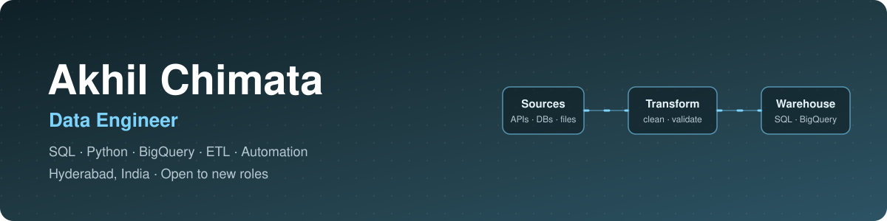
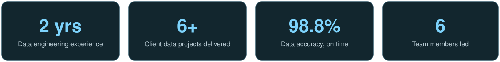

## 👨‍💻 About me

I'm a Data Engineer with 2 years of experience building **ETL pipelines, data integrations, SQL transformations and workflow automation** on an enterprise SaaS data platform. I take client data from raw source systems to clean, validated and production-ready.

- 🔁 Led a **1-year migration** of legacy QlikView logic to SQL, automated end to end
- 🤖 Built and shipped **Python RPA bots** to production
- 🧑‍💼 Led a **6-member team** on a large enterprise data implementation, delivered on schedule
- 🌱 Currently learning **PySpark, Apache Airflow, dbt** and cloud data warehousing
- 📍 Open to Data Engineer roles in **Hyderabad, Remote or Hybrid**

## 📊 At a glance

## 💼 Experience

| Role | Company | When |
|---|---|---|
| **Implementation Engineer (Data)** | Asset10 Software | Oct 2025 – Present |
| **Jr. Data Engineer** | Implere Technologies | Oct 2024 – Oct 2025 |
| **AI & ML Intern** | Xinthe Technologies | Nov 2023 – Mar 2024 |

🎓 B.Tech, Computer Science & Engineering (AI & ML), 2020 – 2024

## 🛠️ Tech stack

**Data & databases** 

**Languages & libraries** 

**Tools** 

**Learning now** 

## 📂 Projects

| Project | What it does | Stack |
|---|---|---|
| 🌐 [Language Translation Web App](https://github.com/AkhilCH09/Language_Translation) | Translates text between 52 languages in the browser using a pre-trained multilingual Transformer | Flask · Hugging Face Transformers · PyTorch |

